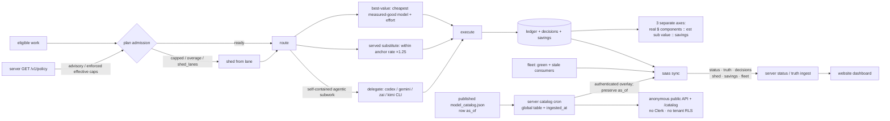
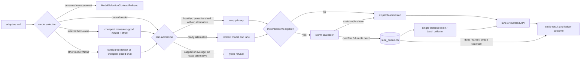
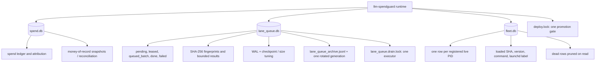

# Architecture diagrams

## Active spend management and org truth flow

The active path acts before dispatch, records the economic outcome on three separate axes, and publishes scrubbed
operational truth to the website. Effective caps travel the other direction and are enforced locally
([`src/spendguard/manage/admission/plan_admission.py`](https://github.com/llmspendguard/llm-spendguard/blob/main/src/spendguard/manage/admission/plan_admission.py),
[`src/spendguard/manage/routing/route_utility.py`](https://github.com/llmspendguard/llm-spendguard/blob/main/src/spendguard/manage/routing/route_utility.py),
[`src/spendguard/manage/token_operations/delegate_router.py`](https://github.com/llmspendguard/llm-spendguard/blob/main/src/spendguard/manage/token_operations/delegate_router.py),
[`src/spendguard/analyze/measurement/guard.py`](https://github.com/llmspendguard/llm-spendguard/blob/main/src/spendguard/analyze/measurement/guard.py), [`src/spendguard/egress/saas.py`](https://github.com/llmspendguard/llm-spendguard/blob/main/src/spendguard/egress/saas.py)).



## End-to-end governed call and durable work flow

The synchronous and storm paths share admission and settlement concepts, but queue use is path-dependent: ordinary calls may record an open queue row when `advisor.route_through_queue` is enabled, while storm overflow reaches `lane_queue.db` through the durable batch executor. The explicit branches below avoid implying that every call is always queued ([`src/spendguard/generate/execution/adapters.py:688`](https://github.com/llmspendguard/llm-spendguard/blob/main/src/spendguard/generate/execution/adapters.py#L688), [`src/spendguard/generate/execution/schema.py:-71`](https://github.com/llmspendguard/llm-spendguard/blob/main/src/spendguard/generate/execution/schema.py#L-71), [`src/spendguard/generate/execution/schema.py:-5`](https://github.com/llmspendguard/llm-spendguard/blob/main/src/spendguard/generate/execution/schema.py#L-5), [`src/spendguard/manage/token_operations/storm_submit.py:155`](https://github.com/llmspendguard/llm-spendguard/blob/main/src/spendguard/manage/token_operations/storm_submit.py#L155)).



## Three-database state model

`spend.db` is money-of-record, `lane_queue.db` is transient durable work state, and `fleet.db` is a pruned live-process registry. Queue connections receive WAL tuning and bounded archive maintenance; deploy and drain use separate process locks ([`src/spendguard/store/configuration/config_store.py:537`](https://github.com/llmspendguard/llm-spendguard/blob/main/src/spendguard/store/configuration/config_store.py#L537), [`src/spendguard/manage/token_operations/lane_queue.py:1127`](https://github.com/llmspendguard/llm-spendguard/blob/main/src/spendguard/manage/token_operations/lane_queue.py#L1127), [`src/spendguard/platform/fleet.py:419`](https://github.com/llmspendguard/llm-spendguard/blob/main/src/spendguard/platform/fleet.py#L419)).



## Release propagation

The comparison uses a process's frozen loaded SHA against the live green pointer. Managed consumers can be kickstarted; unsupervised consumers are warned, and supervised daemons can self-exit only when a fresh process is proven to land on green ([`src/spendguard/platform/fleet.py:553`](https://github.com/llmspendguard/llm-spendguard/blob/main/src/spendguard/platform/fleet.py#L553), [`src/spendguard/platform/fleet.py:647`](https://github.com/llmspendguard/llm-spendguard/blob/main/src/spendguard/platform/fleet.py#L647), [`src/spendguard/platform/release.py:136`](https://github.com/llmspendguard/llm-spendguard/blob/main/src/spendguard/platform/release.py#L136), [`src/spendguard/interface/cli.py:537`](https://github.com/llmspendguard/llm-spendguard/blob/main/src/spendguard/interface/cli.py#L537)).

```mermaid
sequenceDiagram
    participant O as Operator / deploy
    participant G as Green pointer
    participant F as fleet.db comparison
    participant M as Managed consumer
    participant U as Unsupervised consumer
    participant D as Self-checking daemon

    O->>O: acquire deploy lock and run gate
    O->>G: promote committed SHA
    O->>F: restart_stale(apply=true)
    F->>F: compare frozen served_sha to green SHA
    alt stale and launchd-managed
        F->>M: launchctl kickstart -k
        M-->>G: respawn and import green code
    else stale and unsupervised
        F-->>O: warn; manual restart required
        Note over U: Never killed automatically
    end
    D->>G: should_respawn at a safe point
    alt loaded SHA stale and live HEAD equals green
        D->>D: exit_if_stale()
        D-->>G: supervisor respawns on green
    else unknown or respawn would not land on green
        D->>D: keep running; avoid exit loop
    end
```
